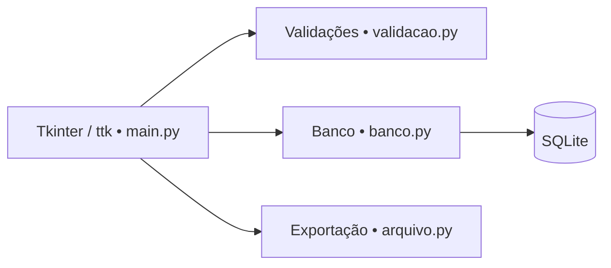

<div align="center">

# 🏫 Sistema de Gestão Escolar
### Aplicação desktop para cadastro acadêmico


</div>

## 🎯 Visão geral

Aplicação desktop para **cadastro e acompanhamento de alunos, disciplinas, matrículas e notas**, construída com Python, Tkinter e SQLite. O projeto separa interface, persistência, validações e exportação de arquivos em módulos próprios.

## ✨ Funcionalidades

| Módulo | Recursos |
|---|---|
| 👩‍🎓 Alunos | Cadastro, consulta, matrícula sequencial e validações |
| 📚 Disciplinas | Cadastro com professor, turno, sala e série |
| 🧾 Matrículas | Associação entre alunos e disciplinas, com unicidade no banco |
| 📝 Notas | Avaliações, lançamento de resultados e cálculo de médias |
| 📊 Consultas | Visualização de registros relacionados |
| 📁 Exportação | Rotinas para gerar arquivos CSV de dados acadêmicos |

## 🏗️ Arquitetura



```text
main.py        # Aplicação e interface gráfica
banco.py       # Schema e operações SQLite
validacao.py   # Regras de validação
arquivo.py     # Exportações CSV
database/      # Criado localmente para o SQLite
```

O schema prevê chaves primárias, vínculos entre tabelas e restrições de unicidade para matrículas e avaliações.

## 🚀 Executar localmente

**Pré-requisitos:** Python 3 com `tkinter` e bibliotecas padrão disponíveis, ambiente gráfico e permissão para criar arquivos locais.

```bash
git clone https://github.com/WalterMatheusgg/Sistema_de_Gestao_Escolar.git
cd Sistema_de_Gestao_Escolar
python3 main.py
```

A função `init_db()` inicializa a estrutura SQLite no início da aplicação. Os dados ficam em um arquivo local criado dentro de `database/`.

> Execute com dados de teste. O sistema é um projeto de demonstração; não presume requisitos de privacidade, backups, acesso multiusuário ou homologação para uso institucional.

## 🧠 Diferenciais demonstrados

- Interface desktop separada da camada de persistência.
- Modelagem relacional simples com vínculos e restrições.
- Rotinas de consulta e exportação.
- Validação de campos e tratamento de fluxos de cadastro.

## 👨‍💻 Autor

**Walter Matheus Soares da Silva** · Desenvolvedor Full Stack  
[GitHub](https://github.com/WalterMatheusgg) · [LinkedIn](https://www.linkedin.com/in/walter504/)
